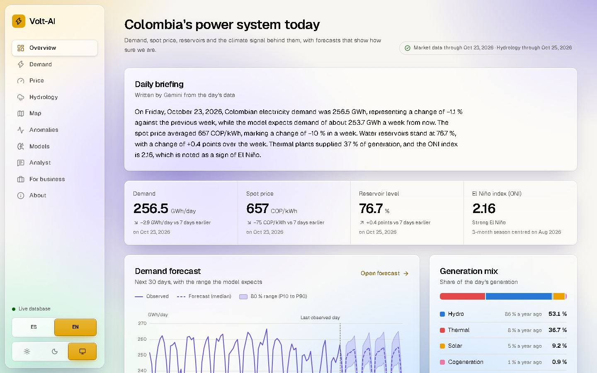
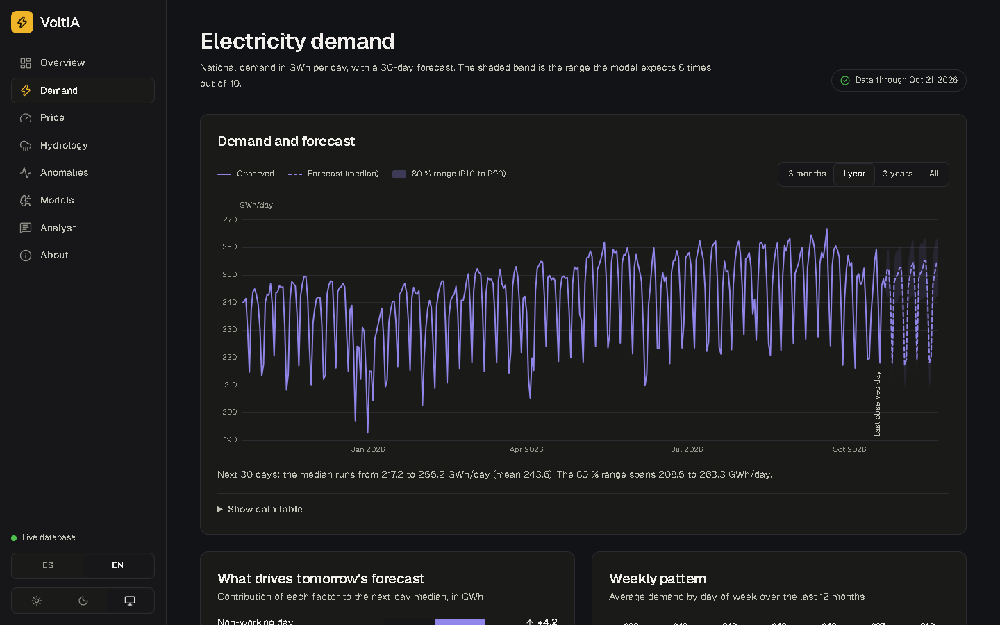

# Volt-AI

**Inteligencia energética para Colombia.** Volt-AI ingiere los datos públicos del mercado eléctrico nacional (XM), pronostica la demanda y el precio de bolsa con bandas de incertidumbre, detecta anomalías, explica qué mueve cada pronóstico y ofrece un analista con IA que responde preguntas con datos reales.

**Demo en vivo: <https://voltia-xi-five.vercel.app/es>** · [English](README.md) · [Para empresas](https://voltia-xi-five.vercel.app/es/business) · [Requisitos](docs/requirements.md) · [Arquitectura](docs/architecture.md) · [Ficha del modelo](docs/model-card.md) · [Decisiones](docs/adr) · [Runbook](docs/runbook.md)



## Qué hace

- **Pronostica** la demanda diaria a 30 días y el precio de bolsa a 14 días, con bandas P10/P50/P90 calibradas.
- **Evalúa con honestidad** mediante backtesting de origen rodante frente a baselines (estacional ingenuo y ETS) y publica cada resultado con su margen de error.
- **Explica** cada pronóstico con los factores SHAP en lenguaje claro.
- **Vigila la hidrología y El Niño**: nivel de embalses, aportes y el índice ONI.
- **Detecta anomalías** como el confinamiento de 2020 y los años de El Niño.
- **Responde preguntas** con un analista de IA limitado a herramientas tipadas y validadas. Nunca ejecuta SQL libre y, si el modelo no está disponible, responde con resúmenes fijos.
- **Escribe un informe diario** en los dos idiomas a partir de las cifras del día.
- **Expone una API REST** en `/api/v1` con especificación OpenAPI.
- **Funciona en español y en inglés**, con tema claro y oscuro.



## Resultados medidos

Backtesting de origen rodante, 50 orígenes en un calendario fijo (cada 21 días), intervalos del 80 % (tablas y método completos en la [ficha del modelo](docs/model-card.md)):

| Objetivo | Frente a estacional ingenuo | Frente a ETS | Cobertura P10–P90 (nominal 80 %) |
| --- | --- | --- | --- |
| Demanda, 30 días | MASE 42,3 % menor, gana en 46 de 50 orígenes | MASE 42,7 % menor, gana en 45 de 50 | 0,82 |
| Precio de bolsa, 14 días | MASE 33,3 % menor, gana en 42 de 50 | 14,2 % menor, pero el intervalo de la diferencia incluye el cero; claramente mejor solo en los primeros días | 0,81 |

En error porcentual medio (MAPE), el pronóstico de demanda se equivoca en promedio 1,9 % frente a 3,4 % de las referencias, y el de precio a 1 a 3 días, 10,7 % frente a 15,3 % de ETS y 29,8 % de la referencia estacional ingenua. Pasada una semana el modelo de precio queda a la par con ETS, así que el sitio presenta el precio como un rango calibrado.

## Tecnología

| Capa | Tecnología |
| --- | --- |
| Pipeline | Python 3.12, uv, pandas, pandera, LightGBM, statsmodels, SHAP, SQLAlchemy |
| Base de datos | PostgreSQL en Neon (plan gratuito); rol de solo lectura para la web |
| Web | Next.js 16, TypeScript, Tailwind CSS 4, Apache ECharts |
| IA | Gemini Flash con respaldo en Flash-Lite mediante el AI SDK de Vercel (opcional) |
| Entrega | GitHub Actions (CI y pipeline diario) y Vercel |

Todo corre en planes gratuitos.

## Calidad

- Pipeline: ruff, mypy y 142 tests con 97 % de cobertura, sin red en CI.
- Web: eslint, tsc, vitest, build de producción y 75 comprobaciones de Playwright con escaneo de accesibilidad axe en ambos temas.
- Seguridad: CSP estricta y cabeceras de seguridad, un rol de base de datos que no puede escribir (salvo la tabla de límites), verificación de Origin, tope de tamaño y límites por cliente en el chat, ningún secreto en el repositorio.
- Reproducible: lockfiles en ambos lados y acciones fijadas por commit.

## Ejecutarlo en local

```bash
# pipeline (usa SQLite si DATABASE_URL no está definida)
cd pipeline && uv sync
uv run voltia backfill && uv run voltia train --predict && uv run voltia anomalies && uv run voltia brief

# web (usa datos de ejemplo si no hay base de datos)
cd web && npm ci && npm run dev
```

El despliegue, los secretos y la programación diaria están en [docs/deployment.es.md](docs/deployment.es.md); qué hacer cuando algo falla, en [docs/runbook.md](docs/runbook.md).

## Estructura del repositorio

```
pipeline/   Paquete Python: fuentes, validación, features, modelos, informe, CLI
web/        Aplicación Next.js y API REST
db/         Migraciones SQL versionadas
docs/       Requisitos, arquitectura, ADRs, ficha del modelo, guía de despliegue, runbook
```

## Licencia

MIT. Ver [LICENSE](LICENSE).
