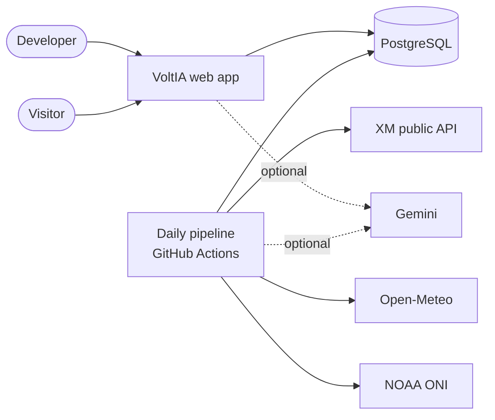
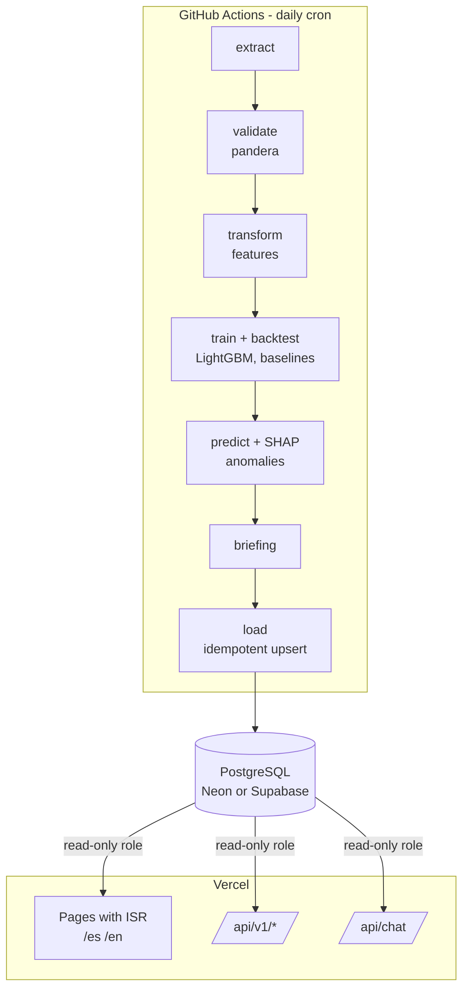

# Architecture

## Context (C4 level 1)

## Containers (C4 level 2)

## Data flow

1. `voltia update` fetches the days missing since the last stored date, validates them and upserts them. `voltia backfill` does the same from 2018-01-01 in 31-day windows.
2. `voltia train` rebuilds features per cutoff, runs the rolling-origin backtest, fits the final models and stores metrics in `model_runs`.
3. `voltia predict` writes P10/P50/P90 forecasts and SHAP contributions to `forecasts`, and anomalies to `anomalies`.
4. `voltia brief` writes the ES and EN summaries to `briefings`. It uses Gemini if a key exists, a template otherwise.
5. The web app reads these tables through the `Repository` interface and renders pages with hourly revalidation.

## Data model (summary)

| Table | Content | Key |
| --- | --- | --- |
| `series_daily` | One row per series and day: demand, price stats, reservoir %, inflows, generation by source, emissions, weather, ONI | (series, date) |
| `series_hourly` | Last 90 days of hourly demand and price | (series, timestamp) |
| `forecasts` | Quantile forecasts per target, run and horizon, with top SHAP contributions | (run_id, target, date) |
| `model_runs` | Training date, data range, backtest metrics, baseline metrics | run_id |
| `anomalies` | Date, target, severity, method, explanation | (target, date) |
| `briefings` | Daily summary per language | (date, lang) |
| `rate_limits` | Sliding-window counters for the chat endpoint | (client_key, window) |
| `ingest_log` | Last successful ingest per dataset, for freshness | dataset |

The authoritative definition is in `db/migrations`.

## Cross-cutting concerns

- **Configuration**: environment variables only, loaded with pydantic-settings (Python) and a zod-validated module (web). `.env.example` lists them all.
- **Failure handling**: HTTP clients retry with exponential backoff and a hard timeout. A failed dataset leaves the previous data in place and updates `ingest_log` with the error.
- **Security**: read-only role for the web, typed AI tools, input validation at every API boundary, CSP and related headers, rate limiting, no secrets in the repository.
- **Observability**: structured logs in the pipeline, a `/api/v1/health` endpoint with per-dataset freshness, and the pipeline workflow summary in GitHub Actions.
- **Testing**: unit tests with recorded API responses, an integration test of the pipeline on SQLite, repository contract tests, Playwright end-to-end tests on fixtures.
